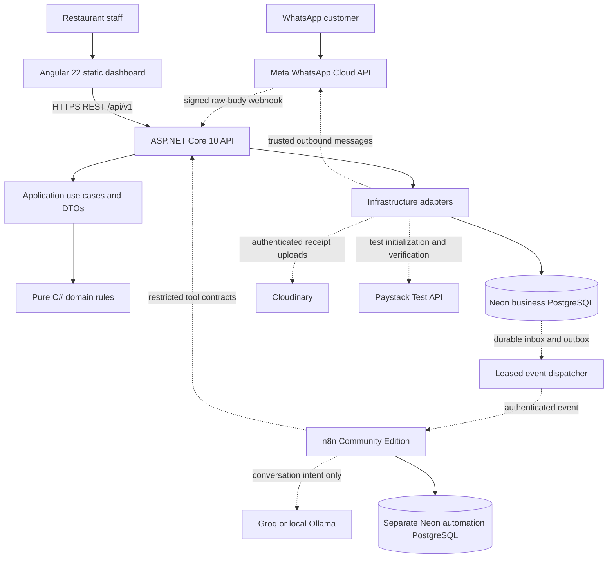
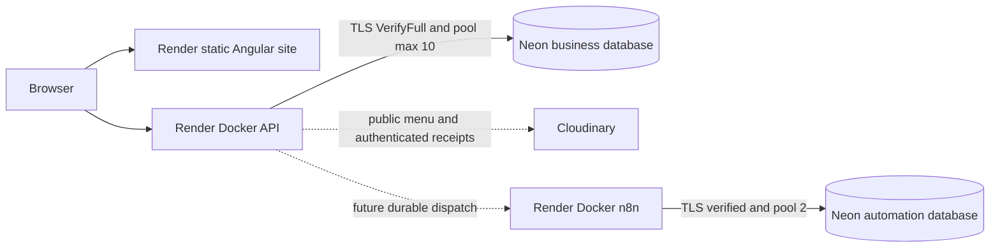

# Architecture and trust boundaries

Phase 1 establishes the application and deployment boundaries. Dashed integrations and financial processing below are target architecture for later phases; only the catalog/readiness path is implemented now.

Domain has no external packages. Application references Domain; Infrastructure references Application and Domain; API composes Infrastructure and Application. EF entities never cross API boundaries. Angular uses typed DTOs and HTTP services, lazy routes, signals for local state, RxJS for polling, and Reactive Forms for menu filtering.

The server owns all future prices, cart mutations, inventory, checkout totals, transitions, financial decisions, and authorization. A screenshot, OCR candidate, redirect, AI tool call, or n8n result cannot mark a payment verified.

## Hosting topology

API binds `0.0.0.0:$PORT` on Render; the Angular output is `dist/restaurant-admin/browser`. n8n uses PostgreSQL persistence and a stable encryption key, with no durable dependency on Render's ephemeral filesystem. Local automation uses a separate database container and volume. Render TLS terminates at the platform edge; forwarded-header trust must be configured explicitly before secure authentication/webhook URL generation in Phase 2/3.

Free services can sleep before a webhook ever reaches the application. Durable ingestion can recover events **after** a successful database commit; it cannot recover a webhook never delivered. Meta retries, reconciliation, replay, and always-on hosting are necessary. Phase 1 does not install a continuously running dispatcher or claim cold-start recovery has been tested.

## Angular feature boundaries

`core/services`: HTTP and public runtime config. `features/dashboard`: health and restaurant summary. `features/menu`: paginated read-only catalog and page-local search. `features/settings`: setup guidance. `shared` and the remaining feature folders reserve the requested structure; they contain no fake implementation. The root shell supplies responsive navigation. Authentication, guards, interceptors, staff navigation, and write forms begin in Phase 2/5/7; no protected operations are exposed before then.

## Storage boundaries

Public menu photos will use ordinary Cloudinary delivery. Sensitive evidence will use `authenticated` delivery, with identifiers and resource/delivery metadata in Neon. Short-lived access will be minted only by an authorized staff endpoint. No receipt URL or file is persisted in Angular or the web-service filesystem. See [Cloudinary plan](cloudinary.md).
