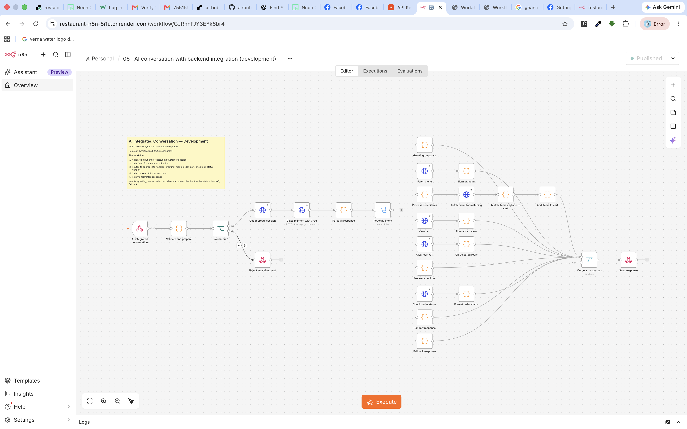

# n8n WhatsApp AI Setup Guide

This guide explains how to configure the n8n instance at `https://restaurant-n8n-5i1u.onrender.com` for WhatsApp AI ordering.

## Prerequisites

1. **Backend API deployed** - The ASP.NET Core API should be deployed on Render
2. **Groq API key** - Sign up at https://console.groq.com for free API access
3. **Meta WhatsApp Business API** - Test phone number configured in Meta Business Suite

## Environment Variables

Set these in Render's n8n service environment:

| Variable | Description | Example |
|----------|-------------|---------|
| `API_BASE_URL` | Backend API URL | `https://restaurant-api-test.onrender.com` |
| `N8N_ENCRYPTION_KEY` | Encryption key for credentials | (32+ random characters) |
| `N8N_WEBHOOK_URL` | n8n webhook base URL | `https://restaurant-n8n-5i1u.onrender.com/` |
| `N8N_EDITOR_BASE_URL` | n8n editor URL | `https://restaurant-n8n-5i1u.onrender.com/` |
| `N8N_HOST` | n8n host | `restaurant-n8n-5i1u.onrender.com` |

## Required Credentials

Create these credentials in n8n:

### 1. Restaurant development webhook (Header Auth)
- **Name**: `Restaurant development webhook`
- **ID**: `restaurantHeaderAuth01`
- **Header Name**: `X-Webhook-Token`
- **Header Value**: (generate a secure token, 32+ characters)

### 2. Restaurant Groq API (Bearer Auth)
- **Name**: `Restaurant Groq API`
- **ID**: `restaurantGroqBearer02`
- **Token**: (your Groq API key from console.groq.com)

### 3. Restaurant Meta Bridge (Header Auth)
- **Name**: `Restaurant Meta Bridge`
- **ID**: `restaurantMetaBridge03`
- **Header Name**: `X-Bridge-Token`
- **Header Value**: (generate a secure token, must match ASP.NET Core `Automation__MetaBridgeToken`)

### 4. Restaurant Meta Test API (Bearer Auth)
- **Name**: `Restaurant Meta Test API`
- **ID**: `restaurantMetaBearer03`
- **Token**: (your Meta WhatsApp Cloud API access token)

## Workflow Configuration

### Workflow 03 - Meta Test Bridge

Before importing, replace these placeholders:

1. `REPLACE_WITH_TEST_PHONE_NUMBER_ID` - Your Meta test phone number ID
2. `REPLACE_WITH_ALLOWLISTED_RECIPIENT` - Your test recipient WhatsApp number (e.g., `233501234567`)
3. `REPLACE_WITH_GRAPH_VERSION` - Meta Graph API version (e.g., `v21.0`)

### Workflow 06 - AI Integrated Conversation

This workflow handles all customer intents:
- **greeting** - Welcome message
- **menu** - Fetches and displays menu from API
- **order** - Adds items to cart
- **cart_view** - Shows cart contents
- **cart_clear** - Empties the cart
- **checkout** - Starts checkout process
- **order_status** - Shows recent orders
- **handoff** - Transfers to human staff
- **fallback** - Help message

## Workflow Activation Order

1. Import all workflows from `automation/workflows/`
2. Configure credentials
3. Update placeholders in workflow 03
4. Activate workflows in this order:
   - `01 - Restaurant development inbox` (optional, for testing)
   - `02 - AI conversation` (optional, mock mode)
   - `06 - AI integrated conversation` (main AI workflow)
   - `03 - Meta test bridge` (connects WhatsApp to AI)

## Backend API Configuration.   

Set these environment variables in the backend API service:

| Variable | Description |
|----------|-------------|
| `Automation__MetaBridgeUrl` | `https://restaurant-n8n-5i1u.onrender.com/webhook/restaurant-dev/meta-bridge` |
| `Automation__MetaBridgeToken` | Same token as `restaurantMetaBridge03` Header Value |

## Testing the Flow

1. **Direct API test**:
   ```bash
   curl -X POST https://restaurant-n8n-5i1u.onrender.com/webhook/restaurant-dev/ai-integrated \
     -H "Content-Type: application/json" \
     -H "X-Webhook-Token: YOUR_TOKEN" \
     -d '{"whatsAppId": "233501234567", "text": "hello"}'
   ```

2. **WhatsApp test**:
   Send a message to your test phone number. The flow:
   - Meta sends webhook to ASP.NET Core
   - ASP.NET Core forwards to n8n Meta Bridge
   - n8n calls AI Integrated workflow
   - Response sent back through Meta API

## Webhook Endpoints

| Endpoint | Description |
|----------|-------------|
| `/webhook/restaurant-dev/inbox` | Development inbox (workflow 01) |
| `/webhook/restaurant-dev/ai-conversation` | Mock AI (workflow 02) |
| `/webhook/restaurant-dev/meta-bridge` | WhatsApp bridge (workflow 03) |
| `/webhook/restaurant-dev/cart` | Cart operations (workflow 04) |
| `/webhook/restaurant-dev/checkout` | Checkout (workflow 05) |
| `/webhook/restaurant-dev/ai-integrated` | Full AI (workflow 06) |

## Troubleshooting

### n8n not responding
- Check if the Render service is sleeping (free tier)
- Ping `/healthz` to wake it up

### Groq API errors
- Verify API key is correct
- Check rate limits at console.groq.com

### Cart operations failing
- Ensure `API_BASE_URL` environment variable is set
- Verify backend API is running

### Meta webhook not working
- Check Meta App webhook configuration
- Verify `Automation__MetaBridgeToken` matches n8n credential
